# Deepfake Voice Detector

**Hanyang University · ITE351 AI & Applications · Fall 2026**

### Members
| Name | Department | University | Email |
|---|---|---|---|
| Zeng Junxiang | Information Systems | Hanyang University | goblin888@hanyang.ac.kr |
| Pa Pa Khine | Information Systems | Hanyang University | khinpapa302@gmail.com |
| Balqis Insyirah | Information Systems | Hanyang University | balqis.ink@gmail.com |
| Shaqweeza | Information Systems | Hanyang University | shqweeza20@hanyang.ac.kr |

### Video presentation
🎥 **[TODO: add YouTube link here]**

### Table of contents
- [I. Introduction](#i-introduction)
- [II. Dataset](#ii-dataset)
- [III. Methodology](#iii-methodology)
  - [1. Turning sound into pictures (log-Mel spectrograms)](#1-turning-sound-into-pictures-log-mel-spectrograms)
  - [2. Removing "cheating" shortcuts](#2-removing-cheating-shortcuts)
  - [3. Splitting by speaker](#3-splitting-by-speaker)
  - [4. The five models we compared](#4-the-five-models-we-compared)
  - [5. Training setup](#5-training-setup)
  - [6. Tools and libraries](#6-tools-and-libraries)
  - [7. Code walkthrough (scripts 00–09)](#7-code-walkthrough-scripts-0009)
- [IV. Evaluation & Analysis](#iv-evaluation--analysis)
- [V. Related Work](#v-related-work)
- [VI. Conclusion & Discussion](#vi-conclusion--discussion)

---

## I. Introduction

The rapid advancement of generative AI has fueled a surge in sophisticated voice phishing scams, where synthetic voice clones impersonate individuals using deepfake technology to deceive victims into financial fraud. Recent studies by researchers from Harvard and Meta reveal that approximately 1 in 6 adults could comply with emotional and relationship-based AI voice-cloning scams, such as a family emergency, which is more persuasive than the typical call center impersonation **[TODO: add source]**. Researchers warn that as this technology spreads, scam calls will become fully automated and the cost of mass dialing will plummet, making scalable defense mechanisms urgent.

Our objective is to develop a baseline deepfake voice detector by training and comparing the performance of various models to combat this increasing problem. To accomplish this, we use the [In-the-Wild dataset](https://huggingface.co/datasets/mueller91/In-The-Wild) introduced by Müller et al. (2022), which contains 31,779 real and fake audio recordings from public figures and is released under CC BY-SA 4.0. We split the dataset by speaker into two parts: 70% for training and 30% for the validation set, process raw audio files via librosa to extract log-Mel spectrogram features, and train image-based and hybrid neural network architectures on a local NVIDIA RTX 3060 GPU.

Once trained, the models are thoroughly evaluated to assess their effectiveness, including an error analysis of where and why they fail. Ultimately, this project explores practical data-driven pipelines to safeguard individuals against automated audio-based security threats.

---

## II. Dataset

We use the **In-the-Wild** dataset by Müller et al. (2022), from the paper *"Does Audio Deepfake Detection Generalize?"* (Interspeech 2022). It is free to use under the CC BY-SA 4.0 license.

- **Download:** [Hugging Face – mueller91/In-The-Wild](https://huggingface.co/datasets/mueller91/In-The-Wild) (also mirrored on [Kaggle](https://www.kaggle.com/datasets/abdallamohamed312/in-the-wild-audio-deepfake))
- **What's inside:** real and fake speech clips of **54 public figures** (politicians, actors, celebrities), collected from social media and video sites. "In the wild" means the audio is messy and realistic, not recorded in a clean studio.

| | Real (bona-fide) | Fake (spoof) | Total |
|---|---:|---:|---:|
| Clips | 19,963 (62.8%) | 11,816 (37.2%) | **31,779** |
| Hours of audio | 20.8 h | 17.1 h | 37.9 h |
| Median clip length | 3.0 s | 4.1 s | |
| Median loudness | −26.1 dBFS | −28.5 dBFS | |

All clips are 16 kHz mono, with no clipping.

**Two things we noticed while exploring the data:**

1. **The classes are not balanced.** There are about 1.7 real clips for every fake clip. A lazy model that always says "real" would already get 63% accuracy, so we cannot rely on accuracy alone. We also report precision, recall, F1, ROC-AUC and EER.
2. **The dataset has "shortcuts".** Fake clips are, on average, **longer** (by about 1 second for the same speaker) and **quieter** (by about 2.4 dB). Loudness alone could already separate real from fake fairly well for many speakers (median per-speaker AUC 0.744). A model could "cheat" by learning *"quiet and long = fake"* instead of learning what an AI voice actually sounds like. We fix this in preprocessing (Section III.2).

<p align="center">
  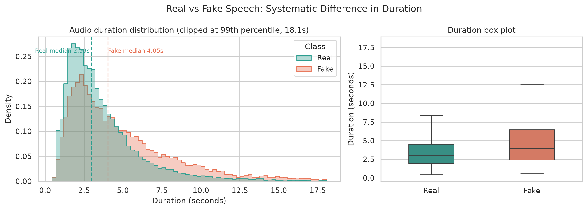
  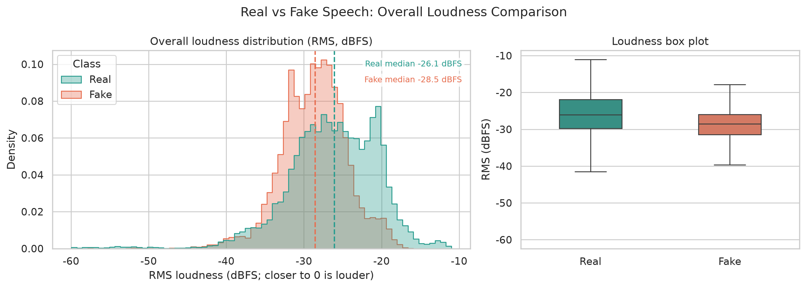
  <br><em>Fig. 1. Fake clips tend to be longer (left) and quieter (right) than real clips.</em>
</p>

<p align="center">
  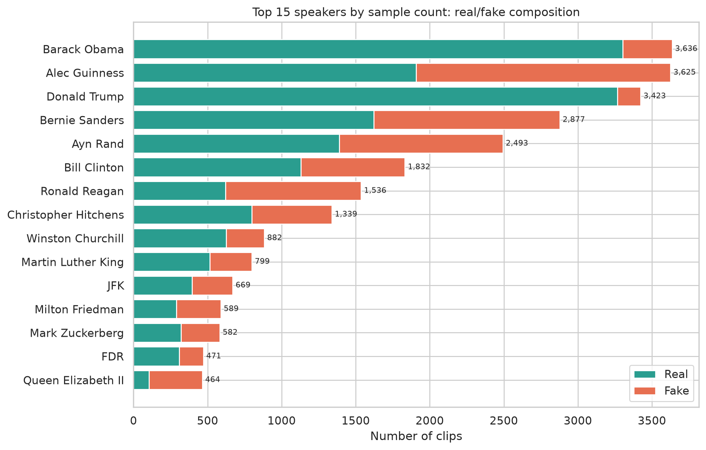
  <br><em>Fig. 2. Real/fake ratio differs a lot between speakers.</em>
</p>

---

## III. Methodology

Our pipeline in one line:

```
audio file → clean up (4 s, same loudness) → log-Mel spectrogram (128×126 image) → neural network → real / fake
```

### 1. Turning sound into pictures (log-Mel spectrograms)
Neural networks are very good at finding patterns in images, so we convert each audio clip into an image called a **log-Mel spectrogram**. It shows **time** on the x-axis, **pitch/frequency** on the y-axis, and **energy** as color. AI-generated voices often leave small marks in this picture (for example, missing or unusual high-frequency energy) that humans cannot hear but a model can see.

Settings (using `librosa`): 16 kHz audio, FFT window 2048, hop length 512, 128 Mel bands from 20 Hz to 8 kHz, converted to decibels and clipped to the range −80 to 0 dB. Every clip becomes a **128 × 126** matrix.

<p align="center">
  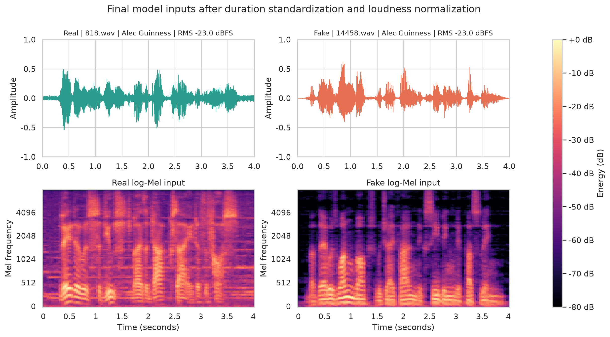
  <br><em>Fig. 3. Waveform and log-Mel spectrogram of a real and a fake clip from the same speaker.</em>
</p>

### 2. Removing "cheating" shortcuts
To stop the model from using length and loudness (Section II), every clip is cleaned before making the spectrogram:

- **Same length:** every clip is made exactly **4 seconds**. Longer clips keep the middle 4 s; shorter clips are **repeated** to fill 4 s (not padded with silence, because silence itself could become a clue).
- **Same loudness:** every clip is set to the same volume (−23 dBFS).

**Result:** the loudness shortcut dropped from AUC 0.649 to **0.505**, which is basically a coin flip, so it no longer helps the model.

<p align="center">
  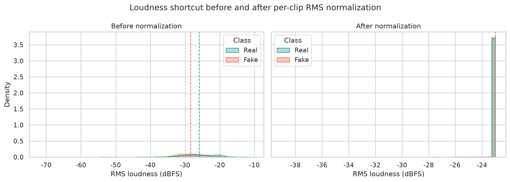
  <br><em>Fig. 4. Loudness of real and fake clips before and after normalization.</em>
</p>

### 3. Splitting by speaker
We split the data **70% training / 30% validation by speaker**. Every clip from one person goes into either training or validation, never both. The models are tested on **14 voices they have never heard**, which is closer to real life, where a scammer can clone anyone.

| | Train | Validation |
|---|---:|---:|
| Speakers | 40 | 14 |
| Clips | 22,233 | 9,546 |
| Fake share | 37.2% | 37.1% |

<p align="center">
  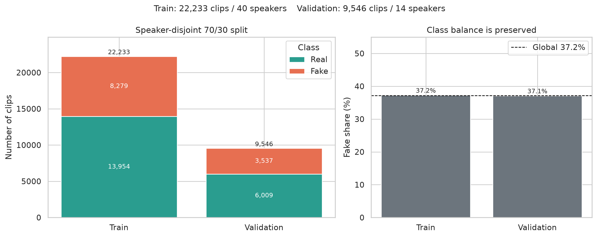
  <br><em>Fig. 5. Both splits keep the same real/fake ratio.</em>
</p>

### 4. The five models we compared

| Model | Type | Idea | Size |
|---|---|---|---:|
| **Simple CNN** | Built from scratch | A small 4-layer image network. This is our **baseline**. | 0.39 M |
| **ResNet18** | Transfer learning | A well-known image model already trained on ImageNet photos, fine-tuned on our spectrograms. | 11.2 M |
| **EfficientNet-B0** | Transfer learning | A smaller, more efficient pretrained image model that balances depth, width and input size. | 4.0 M |
| **CNN + BiGRU** | Hybrid | A CNN finds local patterns, then a recurrent network (GRU) reads them **in time order**, forwards and backwards. | 1.8 M |
| **CNN + BiLSTM** | Hybrid | Same as above but with an LSTM instead of a GRU. | 2.3 M |

**Why these models?** The simple CNN tells us how far a basic approach can go. The two pretrained models test whether knowledge learned from photos helps with spectrograms. The hybrids test whether looking at the **order of sounds over time** helps catch fakes.

For the pretrained models, spectrograms are scaled to 0–1, resized to 224 × 224, and copied into 3 channels, because ImageNet models expect color photos of that size. The last layer is replaced with a new 2-class (real/fake) layer.

### 5. Training setup
All models share the same rules so the comparison is fair:

- **Loss:** cross-entropy with **class weights**, so a missed fake costs more than a missed real (fakes are the smaller class).
- **Optimizer:** AdamW. Pretrained models use a small learning rate (1e-4) for the old layers and a bigger one (1e-3) for the new last layer.
- **SpecAugment:** during training, random time and frequency stripes of the spectrogram are hidden, so the model can't memorize exact images.
- **Early stopping:** after each epoch we check validation ROC-AUC, keep the best epoch, and stop when it stops improving.
- **Hardware:** a laptop with an NVIDIA RTX 3060 (6 GB) GPU on WSL2. Training took between **3 and 33 minutes** per model.

### 6. Tools and libraries
| Library | Used for |
|---|---|
| PyTorch, torchvision | Building and training the neural networks; pretrained ResNet18 / EfficientNet-B0 |
| librosa, soundfile | Loading audio and making log-Mel spectrograms |
| scikit-learn | Metrics (F1, ROC-AUC, confusion matrix) |
| SciPy | Statistical tests in EDA and EER calculation |
| NumPy, pandas | Handling data and tables |
| Matplotlib, seaborn | All graphs and figures |

### 7. Code walkthrough (scripts 00–09)
All code is in the [`src/`](src/) folder. Run the scripts in order:

#### [`00_environment_check.py`](src/00_environment_check.py): Is my computer ready?
Checks the Python version, the installed libraries (PyTorch, librosa, etc.), the GPU, free disk space, and whether the dataset files are in place. It runs before anything else so problems are caught early.

#### [`01_organize_dataset.py`](src/01_organize_dataset.py): Sort the files
Reads the dataset's `meta.csv`, renames the labels `bona-fide → real (0)` and `spoof → fake (1)`, checks that no file is missing, and moves the audio into `real/` and `fake/` folders. It also creates `dataset_index.csv`, a table listing each clip's speaker, label and path. Without `--apply` it only shows a preview and moves nothing.

#### [`02_eda.py`](src/02_eda.py): Explore the data
Measures every clip's length, sample rate and loudness, then uses statistical tests to check whether real and fake clips differ. This is where we discovered the **length and loudness shortcuts** (Section II). It also draws the comparison plots of waveforms and spectrograms.

#### [`03_preprocess.py`](src/03_preprocess.py): Clean the audio and make spectrograms
Makes every clip 16 kHz, 4 seconds and the same loudness, then converts it into a 128 × 126 log-Mel spectrogram. All 31,779 spectrograms are saved into one file for fast loading (about 24 minutes using 12 CPU workers).

#### [`04_split_dataloader.py`](src/04_split_dataloader.py): Split by speaker
Tries 5,000 random ways of dividing the 54 speakers and picks the one closest to a 70/30 split with the same real/fake ratio on both sides. It computes the normalization mean and standard deviation **from the training set only**, so no validation information leaks into training. It also builds the PyTorch DataLoaders that feed batches of 32 spectrograms to the models.

#### [`05_train_cnn.py`](src/05_train_cnn.py): Model A, the simple CNN
Trains the baseline: 4 convolution blocks (32 → 64 → 128 → 256 channels), average pooling, dropout and a 2-class output. Best epoch: 12. Training time: about 5 minutes.

#### [`06_train_transfer.py`](src/06_train_transfer.py): Model B, ResNet18 and EfficientNet-B0
Fine-tunes the two ImageNet-pretrained models on our spectrograms (see Section III.4). ResNet18 took about 21 minutes (best epoch 10); EfficientNet-B0 took about 33 minutes (best epoch 5).

#### [`07_train_hybrid.py`](src/07_train_hybrid.py): Model C, CNN + BiGRU and CNN + BiLSTM
A 3-layer CNN first shrinks the frequency axis but keeps 31 time steps. Each time step becomes a feature vector, and a **bidirectional GRU or LSTM** reads the sequence. An **attention** layer then decides which moments matter most before the final real/fake decision. Training took 3 minutes (BiGRU) and 6.5 minutes (BiLSTM).

#### [`08_evaluate_models.py`](src/08_evaluate_models.py): Compare all five models
Loads every model's predictions on the same validation clips and calculates accuracy, precision, recall, specificity, F1, ROC-AUC and **EER**. It draws the comparison charts and also breaks results down **per speaker**, which is how we found the Adam Driver problem (Section IV).

#### [`09_error_analysis.py`](src/09_error_analysis.py): Why do the models fail?
Doesn't retrain anything. It studies the mistakes:
- Do all models fail on the same clips?
- Which speakers cause the errors?
- Do the errors depend on clip length, padding or loudness?
- What makes the hardest speaker different from the training data?
- How does changing the decision threshold trade missed fakes against false alarms?

It also lists the most confident mistakes so we can listen to them ourselves.

---

## IV. Evaluation & Analysis

### Metrics in plain words
"Positive" means **fake**.
- **Precision:** of the clips we flagged as fake, how many really were fake?
- **Recall:** of all the fake clips, how many did we catch?
- **F1:** a single score that balances precision and recall.
- **ROC-AUC:** how well the model ranks fakes above reals (1.0 = perfect, 0.5 = guessing).
- **EER (Equal Error Rate):** the error rate at the point where false alarms and missed fakes are equal. **Lower is better.**

### Results on the 14 unseen speakers (9,546 clips)

| Rank | Model | Accuracy | Precision | Recall | F1 | ROC-AUC | EER |
|---:|---|---:|---:|---:|---:|---:|---:|
| 1 | **EfficientNet-B0** | **98.91%** | 99.11% | **97.94%** | **0.9852** | **0.9991** | **1.26%** |
| 2 | ResNet18 | 98.72% | 99.80% | 96.75% | 0.9825 | 0.9975 | 2.18% |
| 3 | Simple CNN | 98.52% | **99.94%** | 96.07% | 0.9797 | 0.9957 | 2.39% |
| 4 | CNN + BiLSTM | 98.54% | 99.48% | 96.58% | 0.9801 | 0.9916 | 2.83% |
| 5 | CNN + BiGRU | 98.48% | 99.53% | 96.35% | 0.9792 | 0.9889 | 2.84% |

<p align="center">
  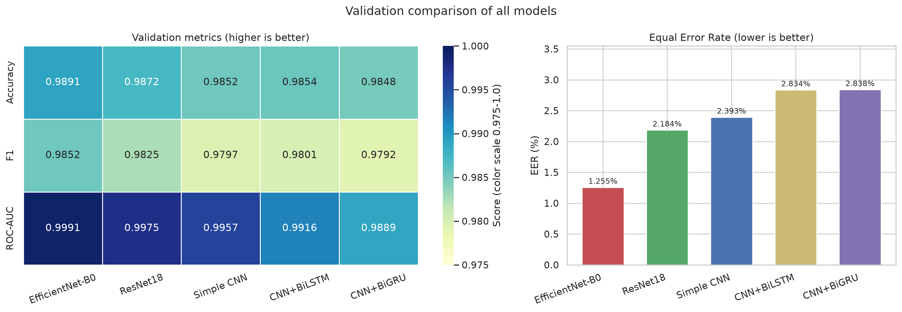
  <br><em>Fig. 6. Metric comparison of all five models.</em>
</p>

<p align="center">
  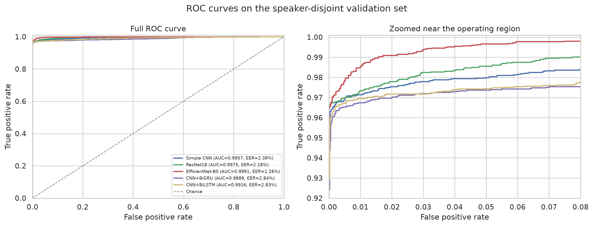
  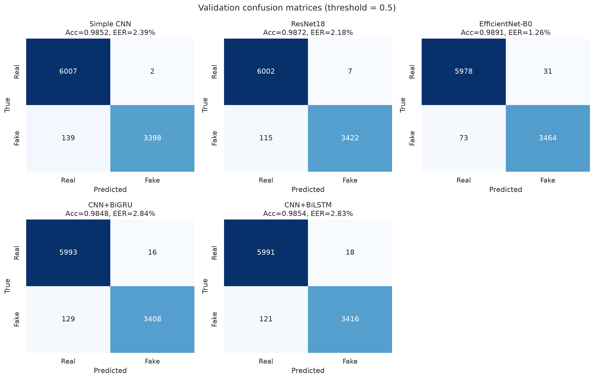
  <br><em>Fig. 7. ROC curves (left) and confusion matrices (right).</em>
</p>

**What this tells us:**
- **EfficientNet-B0 is the best model overall**, with the highest recall, F1 and ROC-AUC and the lowest EER (1.26%).
- **Pretraining helps, but only a little.** Even the simple CNN with only 0.39 M parameters reaches 98.5% accuracy, so log-Mel + CNN is already a strong baseline.
- **The hybrid (CNN + RNN) models did not help.** They ranked last. A likely reason is that each clip only has 31 time steps, which gives the RNN very little time context, and the fake "marks" seem to be **local** rather than spread over time.

### Error analysis: one speaker causes almost all the misses
The overall scores look almost perfect, but breaking them down by speaker shows a big problem:

- **96–99% of the missed fakes in every model come from just one speaker: Adam Driver.**
- 69 of his fake clips fool **all five** models.
- Fake recall on Adam Driver: Simple CNN **2.2%**, ResNet18 **16.8%**, EfficientNet-B0 **47.4%**. Even the best model catches fewer than half of his fakes.
- For **every other** validation speaker (except Kamala Harris, who has only 4 fake clips), all models catch at least 99.7% of fakes.

<p align="center">
  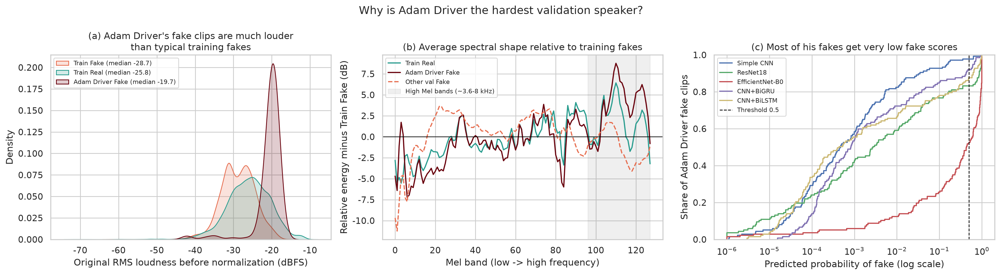
  <br><em>Fig. 8. Adam Driver's fake clips compared with the training data.</em>
</p>

**Why is Adam Driver so hard?** His fake clips have **more high-frequency energy than even real speech**. During training, the models learned roughly that "more high-frequency energy = real". His fakes look "real" by that rule, so the models confidently call them real. His fakes were also originally much louder than the training fakes (about −20 dBFS vs −29 dBFS), which suggests they were made with a **different voice-cloning tool**. This is our best explanation, but we have not proven it.

**Did the shortcuts come back?** No. Once Adam Driver is removed, errors do not depend on clip length, padding or loudness, so our preprocessing worked.

### Changing the threshold
By default, a clip is called "fake" if the model's fake probability is above 0.5. Lowering this threshold catches more fakes but causes more false alarms:

| EfficientNet-B0 threshold | Fakes caught | False alarms | Adam Driver fakes caught |
|---|---:|---:|---:|
| 0.915 (very strict) | 97.0% | 6 | 25.5% |
| **0.5 (default)** | **97.9%** | **31** | **47.4%** |
| 0.244 | 98.5% | 60 | 62.8% |
| 0.004 (very loose) | 99.7% | 290 | 91.2% |

<p align="center">
  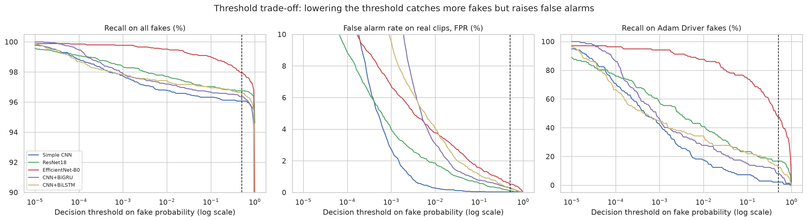
  <br><em>Fig. 9. Trade-off between catching fakes and raising false alarms.</em>
</p>

For a scam-call app, missing a fake is worse than a false alarm, so a lower threshold might be the better choice in practice.

---

## V. Related Work

**Papers and datasets**
- Müller, N. M., Czempin, P., Dieckmann, F., Froghyar, A., & Böttinger, K. (2022). *Does Audio Deepfake Detection Generalize?* Interspeech 2022. https://arxiv.org/abs/2203.16263
- In-the-Wild dataset: https://huggingface.co/datasets/mueller91/In-The-Wild
- Pham, L. et al. (2024). *Deepfake audio detection using spectrogram-based feature and ensemble of deep learning models.* arXiv:2407.01777. https://arxiv.org/abs/2407.01777
- Tan, M. & Le, Q. (2019). *EfficientNet: Rethinking Model Scaling for Convolutional Neural Networks.* ICML 2019. https://arxiv.org/abs/1905.11946
- He, K. et al. (2016). *Deep Residual Learning for Image Recognition* (ResNet). CVPR 2016. https://arxiv.org/abs/1512.03385
- Park, D. S. et al. (2019). *SpecAugment: A Simple Data Augmentation Method for Automatic Speech Recognition.* Interspeech 2019. https://arxiv.org/abs/1904.08779
- **[TODO: Harvard/Meta voice-clone scam study cited in the Introduction]**

**Tools and tutorials**
- McFee, B. et al. (2015). *librosa: Audio and Music Signal Analysis in Python.* Proc. SciPy, 18–24. https://doi.org/10.25080/Majora-7b98e3ed-003
- PyTorch & torchvision: https://pytorch.org
- scikit-learn: https://scikit-learn.org
- Karmakar, T. (2024). *Introduction to EfficientNet.* Kaggle. https://www.kaggle.com/code/iamtapendu/introduction-to-efficientnet

---

## VI. Conclusion & Discussion

**What we built:** a full pipeline that turns speech into log-Mel spectrograms, removes the length and loudness shortcuts, and compares five neural networks on speakers they have never heard.

**What we found:**
1. **EfficientNet-B0 works best** (F1 0.985, ROC-AUC 0.999, EER 1.26%), but a simple CNN is surprisingly close.
2. **More complex is not always better.** Adding an RNN to model time did not improve results.
3. **A 99% score can hide a total failure.** Almost all missed fakes came from a single speaker whose fakes were probably made with a different tool. A detector that looks perfect on average can still fail completely on a new voice-cloning method, which is exactly what a scammer would use.

**Limitations:**
- Only **one** train/validation split with 14 validation speakers. The results depend on which speakers ended up in validation.
- **No separate test set.** The validation set was also used to pick the best epoch, so the scores are slightly optimistic.
- **Only one dataset.** We have not tested on phone-call audio, compressed audio, or newer voice-cloning tools.
- Each model was trained only **once**, so small differences between models may not be meaningful.

**Future work:** test on other datasets and real phone-call audio, use speaker-level cross-validation, add training data from more voice-cloning tools, and use explanation methods (such as saliency maps) to see what the models actually look at.
